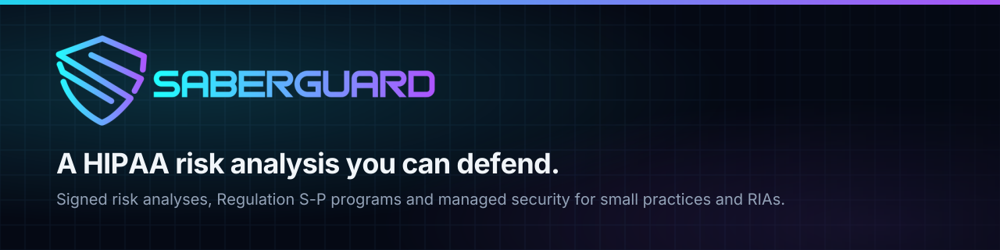

  <picture>
    <source media="(prefers-color-scheme: dark)" srcset="assets/readme-banner-dark.svg">
    <source media="(prefers-color-scheme: light)" srcset="assets/readme-banner-light.svg">
    
  </picture>

  <a href="https://saberguard.tech/"><b>Website</b></a> ·
  <a href="https://saberguard.tech/services"><b>Services</b></a> ·
  <a href="https://saberguard.tech/pricing"><b>Pricing</b></a> ·
  <a href="https://saberguard.tech/resources"><b>Free resources</b></a> ·
  <a href="https://saberguard.tech/contact"><b>Contact</b></a>

**SaberGuard is a cybersecurity and HIPAA compliance consultancy in Central Massachusetts. Every risk analysis traces each finding to evidence and is reviewed and signed by a person.**

- HIPAA Security Rule risk analyses for small medical, dental and behavioral health practices, fixed fee by practice size
- Regulation S-P programs, fractional CISO work and IT provider oversight for SEC-registered investment advisers
- Managed security for both audiences, with Ward Agent compliance monitoring on the Managed Security and Fully Managed tiers
- A Massachusetts WISP (201 CMR 17.00) comes with every risk analysis

### Try it

Two free tools, no sign-up:

- **[HIPAA SRA Tool](https://saberguard-llc.github.io/HIPAA-SRA-Tool/)** runs a HIPAA Security Risk Assessment entirely in your browser. No backend and no trackers, and nothing is stored. Print it to PDF for your records. Source: [SaberGuard-LLC/HIPAA-SRA-Tool](https://github.com/SaberGuard-LLC/HIPAA-SRA-Tool)
- **[Website security checker](https://saberguard.tech/security-checker)** grades a site's HTTPS setup, security headers and cookie settings

### Get in touch

Book a scoping call through the [contact page](https://saberguard.tech/contact) or email [info@saberguard.tech](mailto:info@saberguard.tech). To report a security issue, follow [security.txt](https://saberguard.tech/.well-known/security.txt).
